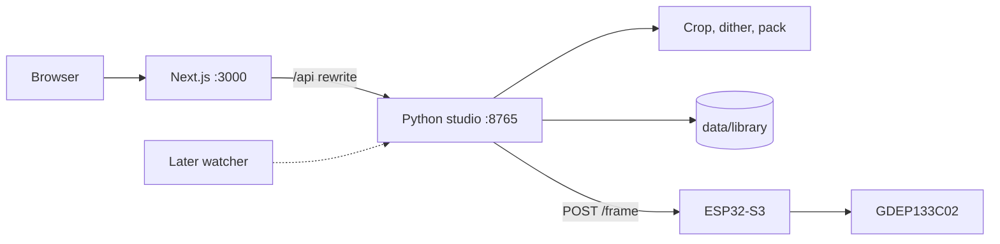

# E-ink art display

A Good Display GDEP133C02 (Spectra 6, 1200×1600, six colors) driven by an ESP32-S3. The board only receives a packed frame and refreshes the glass. Cropping, dithering, the saved library, and the studio UI run on the computer next to it.



A later MQTT client or page watcher would call the same studio routes. Nothing in this repo polls or subscribes yet. `POST /api/show` and `POST /api/next` are the two calls that pusher would use.

## Layout

| Path | What it is |
| --- | --- |
| [firmware/](firmware/) | ESP-IDF app. Wi-Fi, HTTP, and the panel driver. |
| [tools/studio.py](tools/studio.py) | Local API. Library, dither, and pushes. |
| [tools/render_and_push.py](tools/render_and_push.py) | Floyd–Steinberg dither, packing, and a one-shot CLI. |
| [web/](web/) | Next.js studio. The only UI. |
| [display-vendor-files/](display-vendor-files/) | The vendor example, kept for reference. The running firmware is `firmware/`. |
| [docs/](docs/) | Frame format, HTTP routes, firmware, and the studio. |

## Run the studio

Use a Python that has Pillow and `requests`. The ESP-IDF virtualenv does not have Pillow. On this machine the web script calls `/Library/Frameworks/Python.framework/Versions/3.12/bin/python3`. Change that path in [web/package.json](web/package.json) if Pillow lives somewhere else.

```bash
python3 -m pip install pillow requests
cd web
npm install
npm run dev
```

That starts the API on `127.0.0.1:8765` and the UI on `http://127.0.0.1:3000/`. The browser talks to Next, and Next rewrites `/api/*` to the Python server, so curl can hit port 8765 directly.

| Page | Route |
| --- | --- |
| Currently showing | `/` |
| Upload art | `/upload` |
| Select art | `/library` |
| Settings | `/settings` |

A refresh takes about half a minute. Show, Next, and Clear wait that out. A second push while the glass is refreshing returns `409` with `panel is busy`.

## Push one page from the command line

```bash
python3 tools/render_and_push.py --url https://example.com --host 10.0.0.194
```

This screenshots the page at 1200×1600, dithers it, and posts the frame. It does not save the piece into the library. The studio is the path that does.

## Flash the board

ESP-IDF has to be on `PATH` (`source ~/esp/esp-idf/export.sh` for a checkout under `~/esp`). This firmware was built with IDF 6.1. The USB-Serial/JTAG port is usually `/dev/cu.usbmodem*`.

```bash
cp firmware/main/secrets.h.example firmware/main/secrets.h
# set WIFI_SSID and WIFI_PASS in secrets.h

cd firmware
idf.py build
idf.py -p /dev/cu.usbmodem2101 flash monitor
```

`secrets.h` is gitignored. After the first successful join, the board stores the network in NVS and uses that on later boots. The fallback in `secrets.h` is only used when NVS has no saved network. A normal `idf.py flash` keeps NVS. `idf.py erase-flash` clears it, and the next boot uses `secrets.h` again. Every boot paints the glass white once before HTTP starts.

## What stays off git

`data/` holds the library (originals, packed frames, and which piece was last sent). `tools/.cache/` holds the panel address and Chrome's screenshot profile. `firmware/build/`, `sdkconfig`, and `web/.next/` are build output. Passwords are forwarded to the board and are not written by the studio.

## More detail

- [Architecture](docs/architecture.md) — who does the work, and the show / next path
- [Panel and frame format](docs/panel.md) — colors, nibbles, the two chip selects
- [HTTP API](docs/api.md) — studio routes and the board's own routes
- [Firmware](docs/firmware.md) — boot, Wi-Fi, the setup network, build notes
- [Studio](docs/studio.md) — pages, the library on disk, crop
