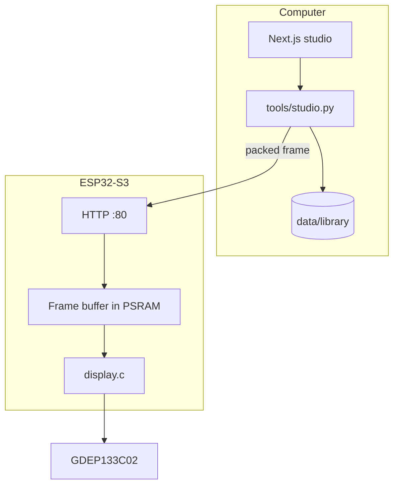
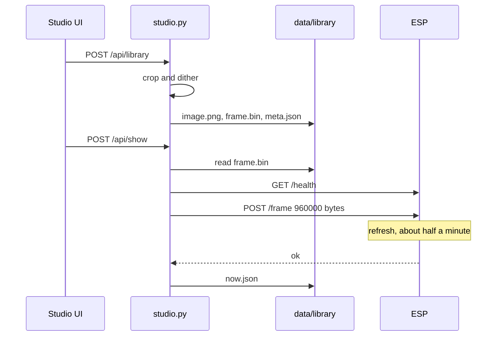

# Architecture

The glass is slow and the ESP is a small machine. Rendering stays on the computer. The board joins the house Wi-Fi, accepts one 960,000-byte frame, and drives the panel. It does not fetch pages, dither, or keep a library.

## What each part owns

**Next.js** (`web/`) is a client. It has no panel protocol and no dither. Pages call `/api/...`, and [web/next.config.ts](../web/next.config.ts) proxies those requests to `127.0.0.1:8765` with a 180 second timeout so a refresh can finish.

**The studio** (`tools/studio.py`) is the system of record. It keeps unsaved uploads in memory, writes saved pieces to `data/library/`, packs a frame once at save time, and pushes that stored frame on Show and Next. The panel address lives in `tools/.cache/studio.json`. Wi-Fi passwords are sent to the board and then dropped.

**The firmware** (`firmware/`) serves `/health`, `/frame`, `/clear`, `/wifi`, `/scan`, and a small setup page. A frame or a clear sets a busy flag for the whole refresh. Another request in that window gets `409`.

**The vendor tree** (`display-vendor-files/`) is the original Good Display example. The driver in `firmware/main/display.c` came from that example. Change the firmware in `firmware/`, and leave the vendor copy as the reference.

## Show and Next

Saving and showing are separate. Upload puts an image in memory. Saving dithers it and writes `frame.bin`. Showing reads that file and posts it. Next is show, pointed at the following id in `data/library/index.json`, wrapping to the first piece.

Clear posts `/clear` and paints the glass white. It leaves `now.json` in place, so the studio still knows which piece was last sent. Deleting a piece removes it from the library and also leaves `now.json` alone.

Sources that have been uploaded but not saved live only in the `SOURCES` dict. They disappear when the API process stops. Saved pieces and Now survive a restart because they are files.

## A later trigger

The UI is one client of the API. A script, an MQTT worker, or a page watcher can call the same routes without going through Next:

- `POST /api/show` with `{"id","host"}` pushes a stored frame.
- `POST /api/next` with `{"host"}` pushes the next stored frame.

Those callers still have to wait out the refresh. The panel will answer `409` if a second frame arrives while `busy` is true.
