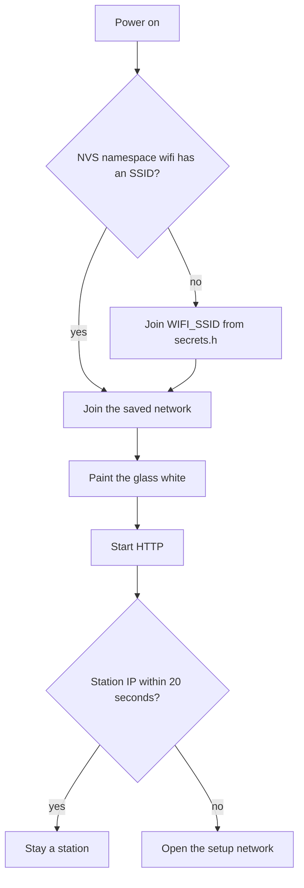
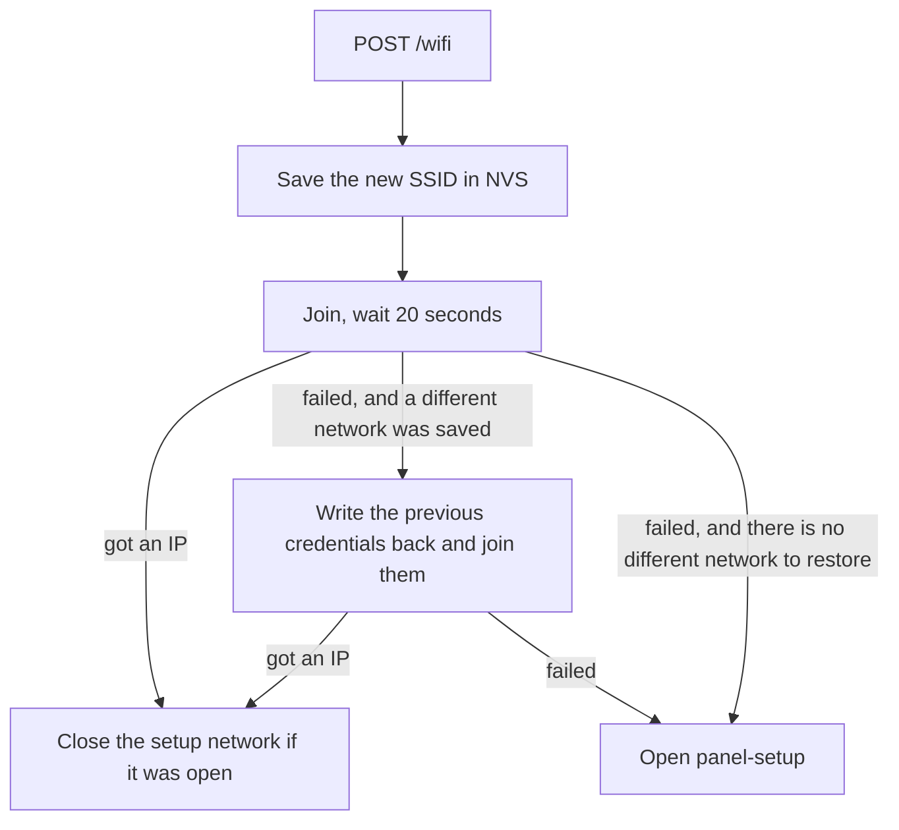

# Firmware

ESP-IDF project `spectra6_demo` in [firmware/](../firmware/). Sources are `main.c` (Wi-Fi and HTTP), `comm.c` (SPI and GPIO), and `display.c` (the vendor refresh). The board is an ESP32-S3 with PSRAM, connected to the panel over SPI, and it talks to the computer over the house Wi-Fi as a station.

## Boot



The white paint overlaps Wi-Fi bring-up and takes about as long as any other refresh. HTTP comes up after that paint. If the join already succeeded, the setup network stays off.

Credentials live in NVS namespace `wifi`, keys `ssid` and `pass`. `secrets.h` is the fallback when those keys are empty, and it is the only copy of the password in the firmware tree. Copy [firmware/main/secrets.h.example](../firmware/main/secrets.h.example) to `secrets.h` before the first build. `secrets.h` is gitignored.

The station config allows WPA2 and WPA3-SAE (`sae_pwe_h2e` is `WPA3_SAE_PWE_BOTH`, PMF capable and not required). Power save is off (`WIFI_PS_NONE`) so the HTTP server stays reachable.

## Changing networks

`POST /wifi` answers `{"ok":true}` first, then a task saves the new credentials and connects. The studio and the phone both use that order, so the response can leave before the association does.



While `switching` is true, another `POST /wifi` returns `409` and `switch in progress`.

## Setup network

If there is still no station IP 20 seconds after boot, or a switch fails and the previous network also fails, the board adds an access point without dropping the station interface:

- SSID `panel-setup`
- Password `panel-setup`
- Page at `http://192.168.4.1/`

That page can scan (`GET /scan`) and submit a network (`POST /wifi`). When the station gets an IP, the access point closes a moment later. The setup password is the string in [firmware/main/main.c](../firmware/main/main.c). It is the recovery network, not the house password.

## Build and flash

```bash
. ~/esp/esp-idf/export.sh
cd firmware
idf.py build
idf.py -p /dev/cu.usbmodem2101 flash monitor
```

`export.sh` has to come from the IDF checkout you actually build with. This project was built with ESP-IDF 6.1. The serial port name depends on the cable. `idf.py flash` leaves the NVS partition in place, so the saved network survives a reflash. `idf.py erase-flash` wipes it, and the next boot falls back to `secrets.h`. Either way, `app_main` paints the glass white before it serves HTTP.

`idf.py monitor` prints `joining wifi ssid ...` and then `wifi connected, ip ...`. `GET /health` on that address is the check that HTTP is up. JSON on the board is parsed and printed by hand. This IDF build does not link cJSON.

## What the vendor folder is for

[display-vendor-files/](../display-vendor-files/) is the Good Display ESP32 example that the driver was taken from. It is not the project `idf.py` builds. If a waveform or a command sequence looks wrong, compare `firmware/main/display.c` with the vendor `GDEP133C02.c` before changing the refresh.
