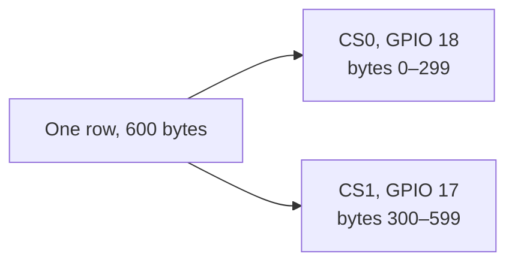

# Panel and frame format

The panel is a Good Display GDEP133C02, a 13.3 inch Spectra 6 display. The active area is 1200 by 1600 pixels. It has six colors and no grayscale. A refresh is a full-panel update and takes roughly 25 to 40 seconds. The glass holds the last image with no power on the pixels, but this firmware still keeps Wi-Fi up so the studio can reach it.

## Colors

Each pixel is one nibble. The values match the vendor driver. Nibble `4` is unused.

| Nibble | Color | Solid-fill byte | RGB used when dithering |
| --- | --- | --- | --- |
| `0` | Black | `0x00` | 0, 0, 0 |
| `1` | White | `0x11` | 255, 255, 255 |
| `2` | Yellow | `0x22` | 255, 255, 0 |
| `3` | Red | `0x33` | 255, 0, 0 |
| `5` | Blue | `0x55` | 0, 0, 255 |
| `6` | Green | `0x66` | 0, 255, 0 |

`epdDisplayColor` fills with the solid-fill byte, so every pixel in a pair is the same color. `WHITE` in [firmware/main/display.h](../firmware/main/display.h) is `0x11`. Boot and Clear both call `epdDisplayColor(WHITE)`.

## Packing

A frame is **960,000 bytes**: 1600 rows of 600 bytes. Two pixels share a byte. The left pixel is the high nibble, the right pixel is the low nibble. Rows run left to right. Packing a row from the right mirrors the picture. An earlier build did that, and the current packer writes the left pixel first.

```
pixel x=0  pixel x=1  pixel x=2  pixel x=3
 nibble hi   nibble lo  nibble hi   nibble lo
└──── byte 0 ────┘    └──── byte 1 ────┘
```

For a pixel at `(x, y)`:

```
index  = y * 600 + x / 2
shift  = 4 when x is even, else 0
```

The packer in [tools/render_and_push.py](../tools/render_and_push.py) writes that layout:

```python
frame[base + x // 2] = (color1 << 4) | color2
```

`POST /frame` rejects any body whose length is not 960,000.

## Two chip selects

The panel is scanned as two halves of each row. SPI runs at 10 MHz on `SPI3`. Chip select is GPIO, not the SPI peripheral's CS pin.



[firmware/main/display.c](../firmware/main/display.c) sends the left half of every row on CS0, then the right half of every row on CS1, then runs the vendor refresh sequence (`PON`, `DRF`, `POF`) and waits on the busy pin.

## Pins

From [firmware/main/pindefine.h](../firmware/main/pindefine.h):

| Signal | GPIO |
| --- | --- |
| SPI clock | 9 |
| SPI data 0 | 41 |
| SPI data 1 | 40 |
| CS0 | 18 |
| CS1 | 17 |
| Reset | 6 |
| Busy | 7 |
| Load switch | 45 |

The 960,000-byte receive buffer is allocated in PSRAM. If that allocation fails, `/frame` cannot run.

## Dither

`dither_and_pack` resizes to 1200×1600, then Floyd–Steinberg dithers to the six RGB points above. Error is spread 7/16 right, 3/16 down-left, 5/16 down, and 1/16 down-right. The studio's preview PNG is decoded from the packed bytes, so the preview is the same six colors the glass will show, including any dither pattern.

## Busy

`s_busy` covers the whole refresh, including the time spent reading the body of `/frame`. `GET /health` returns `{"ip","busy"}`. A second `/frame` or `/clear` while that flag is set returns plain text `busy` and status `409`. The HTTP handlers use `httpd_req_async_handler_begin` so the server can still answer that `409` while the refresh task is running. The studio maps that into `{"error":"panel is busy"}`.
